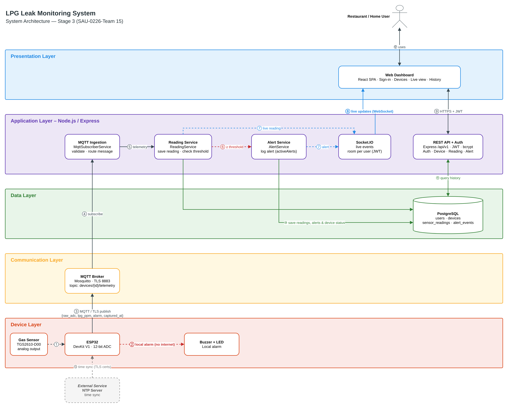
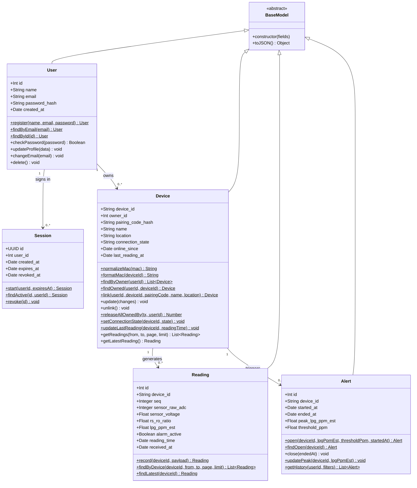
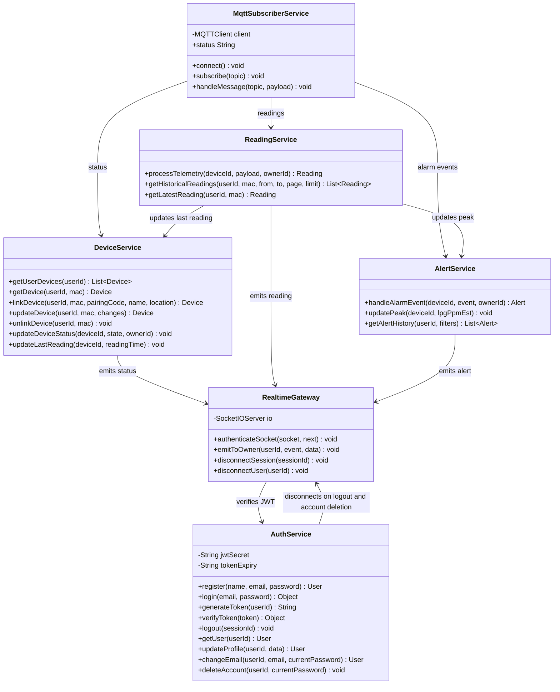
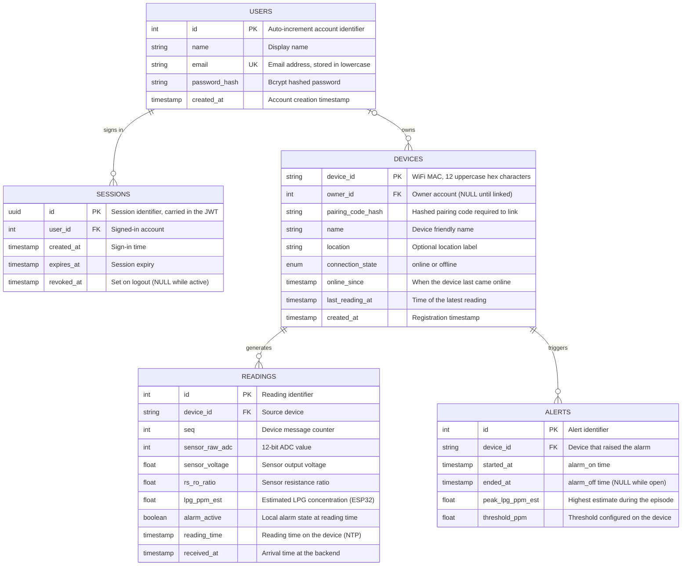
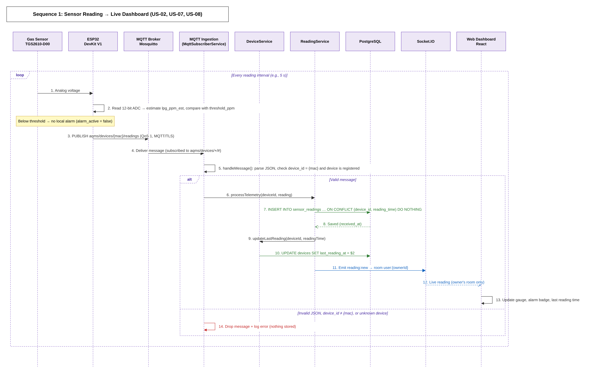
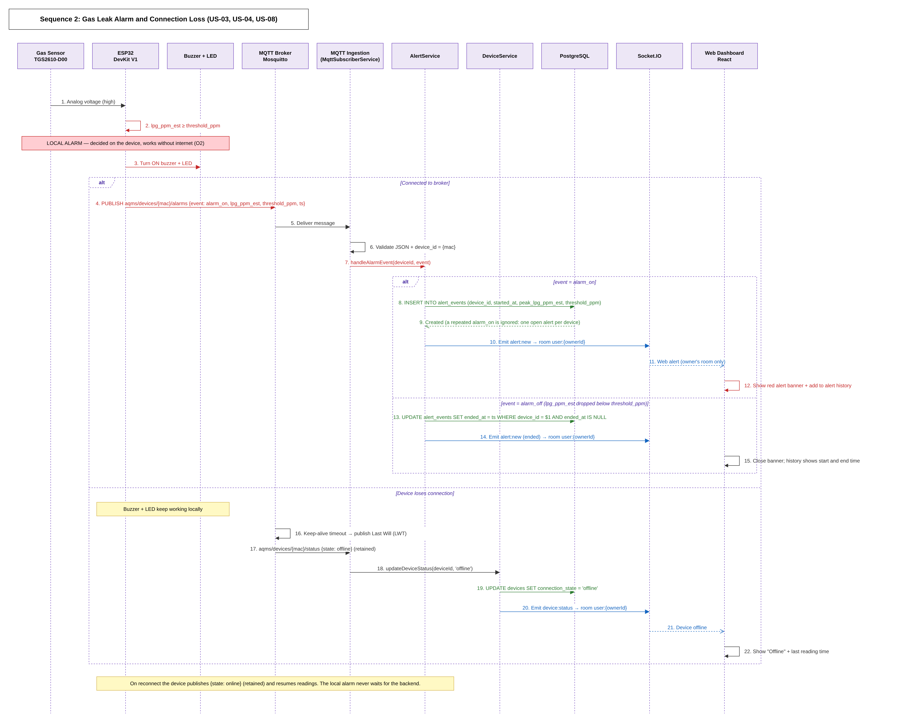
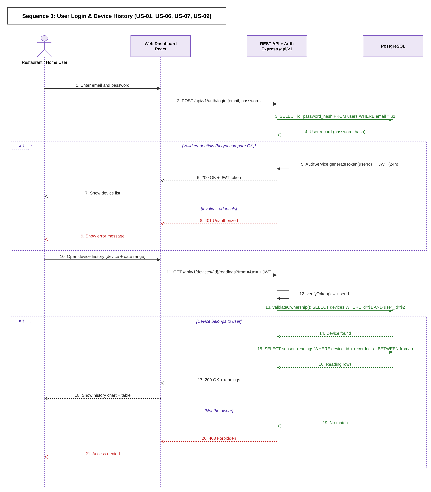

# Stage 3 Report: Technical Documentation

**Team:** SAU-0226-Team 15  
**Project:** Air Quality Monitoring System - LPG Leak Detection MVP  
**Repository:** `air-quality-monitoring-system`  
**Stage dates:** 27 September - 10 October 2026  
**Status:** Written in Stage 3 as the technical plan; updated in November 2026 (Stage 4) to match the system as built and deployed.

This report is the single Stage 3 deliverable. It turns the objectives, scope, and risks in the [Project Charter](stage-2%20project%20charter.md) into a technical plan: what the system does, how its parts fit together, how data moves between them, and why each technology was chosen. Objective IDs (O1-O3) and risk IDs (R1-R4) refer to the charter; user-story IDs (US-01 to US-15) are defined in Section 1.

Where the implementation changed a Stage 3 decision, this report describes what was built, and Section 7 explains the change.

## Contents

1. [User Stories and Mockups](#1-user-stories-and-mockups)
2. [System Architecture](#2-system-architecture)
3. [Components, Classes, and Database Design](#3-components-classes-and-database-design)
4. [Sequence Diagrams](#4-sequence-diagrams)
5. [API Specifications](#5-api-specifications)
6. [SCM and QA Plans](#6-scm-and-qa-plans)
7. [Technical Justifications](#7-technical-justifications)

[Sources](#sources)

---

## 1. User Stories and Mockups

### 1.1 User Stories (MoSCoW Prioritization)

#### Must Have (Essential MVP Objectives)

Core operational requirements required for core system viability, covering Objectives **O1**, **O2**, and **O3**.

| ID | User Story | Priority | Target Objective / Scope |
| --- | --- | --- | --- |
| **US-01** | As a kitchen owner, I want to log in securely to my account, so that I can access and monitor my registered LPG devices. | **Must Have** | Accounts & Access (O3) |
| **US-02** | As a kitchen user, I want to view current sensor readings and estimated LPG concentration levels on the dashboard, so that I can monitor gas safety in real-time. | **Must Have** | Data Display & Sensor (O1) |
| **US-03** | As a kitchen user, I want the local device buzzer and LED to activate instantly when gas concentration exceeds the defined threshold, so that I am alerted to an LPG leak even without internet connectivity. | **Must Have** | Local Alarm & Hardware (O2) |
| **US-04** | As a kitchen owner, I want to see web alert notifications and historical alert logs on the dashboard when a leak occurs, so that I can track incident occurrences over time. | **Must Have** | Web Alerts & History (O1, O2) |
| **US-05** | As a restaurant owner, I want to add and monitor multiple gas detection devices under my single user account, so that I can manage safety across different kitchen areas simultaneously. | **Must Have** | Multi-device Support (O3) |
| **US-06** | As a user, I want my device data and history to be strictly isolated to my account, so that unauthorized users cannot access my operational data. | **Must Have** | Data Isolation & Security (O3) |
| **US-07** | As a kitchen owner, I want to view historical gas readings with timestamps by device, so that I can review past gas trends and audit safety logs. | **Must Have** | Data Storage & History (O1) |


#### Should Have (High-Value Reliability Features)

Features that enhance system usability and operational transparency.

| ID | User Story | Priority | Target Objective / Scope |
| --- | --- | --- | --- |
| **US-08** | As a kitchen owner, I want to see the device connectivity state (online/offline) and the latest reading timestamp on the dashboard, so that I know if the system is actively transmitting data. | **Should Have** | System Reliability (R3) |
| **US-09** | As a kitchen owner, I want to filter historical reading and alert logs by date range or specific device, so that I can quickly investigate specific safety events. | **Should Have** | Dashboard Usability |


#### Could Have (Desirable Enhancements)

Optional features to be implemented if time permits during Phase 4.

| ID | User Story | Priority | Target Objective / Scope |
| --- | --- | --- | --- |
| **US-10** | As a kitchen owner, I want to view the configured alarm threshold limit on the web dashboard, so that I know at what concentration level the local alarm will trigger. | **Could Have** | Dashboard Configuration |
| **US-11** | As a restaurant manager, I want to export historical gas readings and alert logs to a CSV file, so that I can archive safety reports internally. | **Could Have** | Data Reporting |


#### Won't Have (Out of MVP Scope)

Explicitly excluded features per the Project Charter to maintain scope integrity for this release.

| ID | User Story | Priority | Out of Scope Reason |
| --- | --- | --- | --- |
| **US-12** | As a kitchen owner, I want to receive SMS or WhatsApp alert messages during a gas leak event, so that I am notified when away from the dashboard. | **Won't Have** | Explicitly out of scope in Project Charter (MVP limits alerts to local hardware & web dashboard). |
| **US-13** | As a user, I want the system to automatically trigger a gas shut-off valve when a leak is detected, so that the gas supply is cut off automatically. | **Won't Have** | Out of scope due to safety certification, physical solenoid actuator complexity, and hardware constraints. |
| **US-14** | As a restaurant owner, I want to share access to the same device across multiple independent user accounts, so that external staff can log in separately. | **Won't Have** | Out of scope; enforcing strict single-account multi-device ownership rule for MVP simplicity. |
| **US-15** | As a user, I want to receive an OTP code to verify my account ownership upon sign-up, so that my account email is validated. | **Won't Have** | Out of scope for MVP to prevent external service dependencies; standard JWT & bcrypt password authentication provides sufficient access control. |

### 1.2 UI/UX Mockups

The interface is designed in Figma, as required by the mentors: [Figma design file](https://www.figma.com/design/k5UNJkKtfeYt9HBuPiIXqY/Untitled?node-id=0-1&p=f&t=Mank3nL8NS1aXxNC-0).

The Stage 3 plan had four screens (sign-in, devices overview, device details, history). In Stage 4 the device details were merged into the dashboard, and screens for sign-up, adding a sensor, and the profile were added. The built screens are:

| Screen | Purpose | Key elements | User stories |
| --- | --- | --- | --- |
| Sign-in / Sign-up | Create an account or start a session. | Email and password fields, validation messages, Arabic and English. | US-01, US-06 |
| Dashboard | Monitor the selected device live. | Device selector, `Online` / `Offline` badge, estimated-concentration gauge (labeled as an estimate) with the 1000 ppm threshold, safe/alert state, latest reading time, recent alerts. | US-02, US-04, US-05, US-08, US-10 |
| History | Review past readings and leak episodes. | Filters by device and date range, readings and alerts tabs, CSV export. | US-04, US-07, US-09, US-11 |
| Add Sensor | Link a device to the account, or remove one. | MAC address and pairing code form, "My sensors" list with a remove button and confirmation. | US-05 |
| Profile | Manage the account. | Name, change email (current password required), delete account in two steps. | US-01 |

---

## 2. System Architecture



Editable source: [architecture.drawio](diagrams/architecture.drawio)

| # | Flow | Description |
| --- | --- | --- |
| ① | Sensor → ESP32 | Analog voltage read by the 12-bit ADC |
| ② | ESP32 → Buzzer + LED | Local alarm when `lpg_ppm_est` ≥ 1000 ppm (continuous beep from 1500 ppm, off below 800 ppm); decided on the device, works without internet |
| ③ | ESP32 → MQTT Broker | Publish to `aqms/devices/{mac}/readings`, `/alarms`, and `/status` over MQTT/TLS (QoS 1); each device has its own broker credentials. The broker publishes the device's Last Will (`offline`) if it drops |
| ④ | Broker → MQTT Ingestion | `MqttSubscriberService` subscribes to `aqms/devices/+/#`, validates each message, and routes it by topic |
| ⑤ | Ingestion → Reading Service | Readings are validated and stored |
| ⑥ | Ingestion → Alert Service | `alarm_on` opens an alert episode, `alarm_off` closes it |
| ⑦ | Services → Socket.IO | Live readings and alerts |
| ⑧ | Socket.IO → Dashboard | Live updates to the owner's room only |
| ⑨ | Dashboard ↔ REST API | HTTPS + JWT (`/api/v1`) |
| ⑩ | Services → PostgreSQL | Save readings, alerts, and device status |
| ⑪ | REST API ↔ PostgreSQL | Historical queries |
| ⑫ | User ↔ Dashboard | Web browser |
| ⑬ | NTP → ESP32 | Time sync for the `ts` (reading time) of each reading and alarm event |

### 2.1 Deployment

All services run in one Railway project:

| Service | Role | Network |
| --- | --- | --- |
| Backend | Node.js API, MQTT ingestion, Socket.IO, and the built React frontend | One public HTTPS domain for the site, the API (`/api/v1`), and Socket.IO |
| Mosquitto | MQTT broker | Devices: TLS on port 8883, reached from the internet through a Railway TCP proxy (`acela.proxy.rlwy.net:47740`). Backend: port 1883 on Railway's private network (`mosquitto.railway.internal`). The public plain-text 1883 proxy was removed. |
| PostgreSQL | Database | Private network only |

The database schema is created by Prisma migrations, which run before every backend deploy (`npm run migrate`).

---

## 3. Components, Classes, and Database Design

### 3.1 System Components

The system has five tiers. The local alarm runs entirely on the edge tier, so a network failure affects only the web features.

| Tier | Component | Responsibilities |
| --- | --- | --- |
| Edge hardware | ESP32 DevKit V1, Figaro TGS2610-D00 sensor, buzzer (GPIO 25), LED (GPIO 26) | Reads the sensor through a voltage divider on a 12-bit ADC1 pin every 5 s, calculates `lpg_ppm_est`, and turns on the buzzer and LED when `lpg_ppm_est` ≥ 1000 ppm, with or without internet (no alarm during the first 2 minutes of sensor warm-up). Identifies itself by its WiFi MAC address and publishes to `aqms/devices/{mac}/readings` (every reading), `aqms/devices/{mac}/alarms` (`alarm_on` / `alarm_off`), and `aqms/devices/{mac}/status` (`online`, with a Last Will of `offline`). |
| MQTT broker | Eclipse Mosquitto | Receives device messages over MQTT/TLS. Authenticates each device with its own username and password and applies an ACL so a device can publish only under its own `aqms/devices/{mac}/` topics. Publishes a device's Last Will when it stops responding. |
| Backend | Node.js, Express, Prisma, MQTT.js, Socket.IO | Subscribes to `aqms/devices/+/#`, rejects messages whose `device_id` does not match the topic, and stores readings, alert episodes, and connection state. The alarm decision and `lpg_ppm_est` come from the device and are stored as received, so the local alarm and the web alert come from the same decision. Exposes the JWT-protected REST API (`/api/v1`) and pushes live events to each owner's Socket.IO room. |
| Database | PostgreSQL | Stores accounts (`users`), sign-in sessions (`sessions`), devices (`devices`), time-series readings (`readings`), and leak episodes (`alerts`). |
| Frontend | React single-page application | Shows live estimates, connection badges, alert banners, and filterable history through REST and Socket.IO. |

```text
[ Edge Hardware ]            [ MQTT Broker ]           [ Backend ]                  [ Frontend ]
+--------------------+       +----------------+        +-------------------+         +-------------------+
| ESP32 DevKit V1    |       | Mosquitto      |        | Node.js / Express |         | React Dashboard   |
| - TGS2610-D00      |-MQTT->| aqms/devices/  |<-sub---| - MQTT ingestion  |<-REST-->| - Sign-in         |
| - Buzzer + LED     | (TLS) |   {mac}/#      |        | - REST API (JWT)  |         | - Dashboard       |
| (local alarm)      |       | ACL per device |        | - Socket.IO       |--push-->| - History, sensors|
+--------------------+       +----------------+        +---------+---------+         +-------------------+
                                                                 |
                                                           [ PostgreSQL ]
```

### 3.2 Frontend Components

| Component | Screen | Data source | User stories |
| --- | --- | --- | --- |
| `Login`, `Signup` | Sign-in / Sign-up | `POST /auth/login`, `POST /auth/register` | US-01 |
| `AuthContext` | All | Keeps the JWT and user; calls `GET /auth/me` on reload; signs out on `401` | US-01, US-06 |
| `ProtectedRoute` | All except sign-in and sign-up | Blocks pages until the user is signed in | US-06 |
| `Header`, `AppLayout` | All signed-in pages | Navigation, language switch, sign-out | — |
| `Dashboard` | Dashboard | `GET /devices`, `GET /devices/:mac/readings`, `GET /devices/:mac/alerts` | US-02, US-04, US-05, US-08 |
| `Gauge` | Dashboard | Current `lpg_ppm_est`, labeled as an estimate, with the threshold mark | US-02, US-10 |
| `History` | History | Device and date-range filters; `GET /devices/:mac/readings`, `GET /alerts`; CSV export | US-07, US-09, US-11 |
| `AddSensor` | Add Sensor | `POST /devices` with MAC address, pairing code, name, and location; `DELETE /devices/:mac` | US-05 |
| `Profile` | Profile | `PATCH /auth/me`, `PATCH /auth/me/email`, `DELETE /auth/me` | US-01 |
| `client.js` (API client) | — | Adds `Authorization: Bearer <token>` and reads the shared error format | US-06 |
| `LanguageContext` | All | Arabic (right-to-left) and English | — |

### 3.3 Backend Class Diagram

The backend is built around five domain classes that mirror the database tables in the [ER Diagram](#34-er-diagram). Each class reads and writes its table through Prisma. The four main classes extend `BaseModel`. A thin service layer coordinates them and contains every method called in the [Sequence Diagrams](#4-sequence-diagrams). Field names, topics, and endpoints follow the [API Specifications](#5-api-specifications).

#### Domain Model



#### Class Descriptions

| Class | Table | Responsibility | User stories |
| --- | --- | --- | --- |
| `BaseModel` | — | Parent class. Copies the database row into the object and provides `toJSON()`, which each class overrides to choose what the API returns. Persistence is done by Prisma inside each class's methods. | — |
| `User` | `users` | A registered account. `register()` hashes the password with bcrypt and saves the user (`409 EMAIL_TAKEN` if the email exists); `checkPassword()` compares a password with the hash. `delete()` runs one transaction: it releases every device the user owns (`Device.releaseAllOwnedBy`) and then deletes the user; the sessions are deleted by cascade. `toJSON()` never returns the password hash. `id` is an auto-increment integer. | US-01, US-05 |
| `Session` | `sessions` | One sign-in. The JWT carries the session `id`; a token is accepted only while its session exists, has not expired, and has not been revoked. `revoke()` runs on logout. | US-01, US-06 |
| `Device` | `devices` | One ESP32 unit. `device_id` is its WiFi MAC in 12 uppercase hex characters; `normalizeMac()` removes `:` or `-` and converts to uppercase. `link()` attaches the device to an account only if the pairing code matches its hash and it is not already linked. `findOwned()` returns a device only if it belongs to the user, which enforces data isolation in the query itself. `unlink()` and `releaseAllOwnedBy()` free the device and delete its readings and alerts, so the next owner starts with an empty history. `setConnectionState()` applies `online` / `offline` from the status topic. | US-05, US-06, US-08 |
| `Reading` | `readings` | One sensor observation. `lpg_ppm_est` and `alarm_active` come from the ESP32 and are stored as received. `record()` skips a repeated message with the same `(device_id, reading_time)`. | US-02, US-07 |
| `Alert` | `alerts` | One leak episode. `open()` runs on `alarm_on`, `close()` on `alarm_off`, and `updatePeak()` keeps the highest estimate while the alert is open. A device has at most one open alert. | US-04, US-09 |

#### Relationships

| Relationship | Type | Meaning |
| --- | --- | --- |
| `BaseModel` ◁— `User`, `Device`, `Reading`, `Alert` | Inheritance | Every domain class reuses the constructor and `toJSON()`. |
| `User` 1 → 0..* `Session` | Association | A user can be signed in on several devices at once; each session is deleted with its user. |
| `User` 1 → 0..* `Device` | Association | A user owns zero or more devices; each device belongs to at most one user (`US-14` sharing is out of scope). |
| `Device` 1 → 0..* `Reading` | Association | A device produces a continuous series of readings. |
| `Device` 1 → 0..* `Alert` | Association | A device can trigger many alerts over time, one per leak episode. |

#### Service Layer

Services coordinate the domain classes for each use case. Their method names match the Sequence Diagrams.



#### Service Descriptions

| Service | Uses | Responsibility | Sequence |
| --- | --- | --- | --- |
| `MqttSubscriberService` | `ReadingService`, `AlertService`, `DeviceService` | Subscribes to `aqms/devices/+/#`, rejects messages whose `device_id` does not match `{mac}` or belongs to an unregistered device, and routes by topic: `readings`, `alarms`, `status`. Its `status` is reported by `GET /health`. | 1, 2 |
| `DeviceService` | `Device` | Linking with a pairing code, removing a device, and connection state. Every user request goes through `Device.findOwned()`, so another account's device returns `404`. `updateDeviceStatus()` handles both `online` and the broker's Last Will `offline`. | 1, 2, 3 |
| `ReadingService` | `Reading` | Stores each reading, updates the device's `last_reading_at`, and returns paginated history only for the user's own device. | 1, 3 |
| `AlertService` | `Alert` | `handleAlarmEvent()` opens an alert on `alarm_on` and closes it on `alarm_off`; the alarm decision itself is made on the device. | 2 |
| `AuthService` | `User`, `Session` | Registration, sign-in, and sign-out. Issues a JWT that carries the session `id` and checks that session on every request. Changing the email or deleting the account requires the current password (`403 WRONG_PASSWORD` if it is wrong). | 3 |
| `RealtimeGateway` | `AuthService` | Authenticates Socket.IO connections and sends `reading:new`, `alert:new`, and `device:status` only to the owner's room `user:{userId}`. Closes a session's sockets on logout and all of a user's sockets when the account is deleted. | 1, 2 |

#### REST Controllers

Each controller reads the HTTP request, calls one service, and returns the status code and JSON. An authentication middleware verifies the JWT and its session on every route except register, login, and health, and passes `userId` to the controller. A device that belongs to another account returns `404`, so the API does not reveal that it exists.

| Controller | Calls | Endpoints (`/api/v1`) |
| --- | --- | --- |
| `AuthController` | `AuthService` | `POST /auth/register`, `POST /auth/login`, `POST /auth/logout`, `GET /auth/me`, `PATCH /auth/me`, `PATCH /auth/me/email`, `DELETE /auth/me` |
| `DeviceController` | `DeviceService` | `GET /devices`, `POST /devices`, `GET /devices/:mac`, `PATCH /devices/:mac`, `DELETE /devices/:mac` |
| `ReadingController` | `ReadingService` | `GET /devices/:mac/readings`, `GET /devices/:mac/readings/latest` |
| `AlertController` | `AlertService` | `GET /alerts`, `GET /devices/:mac/alerts` |
| `HealthController` | — | `GET /health` |

### 3.4 ER Diagram



### 3.5 Database Schema

The LPG Leak Detection System uses a relational **PostgreSQL** database designed for time-series writes, relational integrity, and data isolation between accounts. The schema is defined in `backend/prisma/schema.prisma` and created by Prisma migrations. Rules that Prisma cannot express (CHECK constraints and a partial unique index) are written as SQL inside the migrations. Field names follow the [API Specifications](#5-api-specifications). The schema has five tables:

1. `users`: Registered accounts.
2. `sessions`: Sign-in sessions, one per signed-in browser.
3. `devices`: ESP32 units, identified by their WiFi MAC address.
4. `readings`: Time-series readings published by each device.
5. `alerts`: One row per leak episode, from `alarm_on` to `alarm_off`.

#### Table: `users`
Stores restaurant and home-kitchen users with hashed credentials.

| Column | Data Type | Constraints | Description |
| :--- | :--- | :--- | :--- |
| `id` | `INTEGER` | PRIMARY KEY, auto-increment | Account identifier |
| `name` | `VARCHAR(100)` | NOT NULL | Display name |
| `email` | `VARCHAR(255)` | UNIQUE, NOT NULL, CHECK (`email = lower(email)`) | Login email address, stored in lowercase (`409 EMAIL_TAKEN` if already registered) |
| `password_hash` | `TEXT` | NOT NULL | Bcrypt hash; never returned by the API |
| `created_at` | `TIMESTAMPTZ` | DEFAULT `now()` | Account creation timestamp |

---

#### Table: `sessions`
One row per sign-in. The JWT carries the session `id`, so a token stops working as soon as its session is revoked or deleted.

| Column | Data Type | Constraints | Description |
| :--- | :--- | :--- | :--- |
| `id` | `UUID` | PRIMARY KEY, DEFAULT `gen_random_uuid()` | Session identifier |
| `user_id` | `INTEGER` | FOREIGN KEY (`users.id`) ON DELETE CASCADE, NOT NULL | Signed-in account |
| `created_at` | `TIMESTAMPTZ` | DEFAULT `now()` | Sign-in time |
| `expires_at` | `TIMESTAMPTZ` | NOT NULL, CHECK (`expires_at > created_at`) | Session expiry (24 hours by default) |
| `revoked_at` | `TIMESTAMPTZ` | NULL | Set on logout |

---

#### Table: `devices`
Tracks each ESP32 unit and the account it is linked to.

| Column | Data Type | Constraints | Description |
| :--- | :--- | :--- | :--- |
| `device_id` | `CHAR(12)` | PRIMARY KEY, CHECK (`device_id ~ '^[0-9A-F]{12}$'`) | WiFi MAC address, 12 uppercase hex characters (e.g., `20500D007324`) |
| `owner_id` | `INTEGER` | FOREIGN KEY (`users.id`) ON DELETE SET NULL, NULL | Owner account; NULL until the device is linked |
| `pairing_code_hash` | `TEXT` | NOT NULL | Bcrypt hash of the pairing code required by `POST /devices` |
| `name` | `VARCHAR(100)` | NULL | Friendly label (e.g., "Main kitchen") |
| `location` | `VARCHAR(150)` | NULL | Optional location label (e.g., "Restaurant A") |
| `connection_state` | enum `connection_state` | DEFAULT `'offline'`, values `online`, `offline` | Set from the device's `status` topic, including the broker's Last Will |
| `online_since` | `TIMESTAMPTZ` | NULL | When the device last came online |
| `last_reading_at` | `TIMESTAMPTZ` | NULL | `reading_time` of the latest stored reading |
| `created_at` | `TIMESTAMPTZ` | DEFAULT `now()` | When the device was registered |

A device is registered by the team in three steps before a user can link it: a broker account in Mosquitto, a row in `devices` with the bcrypt hash of its pairing code, and the firmware flashed with the same credentials. `POST /devices` then sets `owner_id` only if the pairing code matches and the device is not already linked (`409` otherwise). `DELETE /devices/:mac` sets `owner_id`, `name`, `location`, and `last_reading_at` back to NULL and deletes the device's readings and alerts; the row stays, so the device can be linked again with the same pairing code.

---

#### Table: `readings`
Time-series storage for readings published to `aqms/devices/{mac}/readings`.

| Column | Data Type | Constraints | Description |
| :--- | :--- | :--- | :--- |
| `id` | `INTEGER` | PRIMARY KEY, auto-increment | Reading identifier |
| `device_id` | `CHAR(12)` | FOREIGN KEY (`devices.device_id`) ON DELETE CASCADE, NOT NULL | Source device |
| `seq` | `INTEGER` | NULL | Device message counter, used to detect lost or repeated messages in tests |
| `sensor_raw_adc` | `INTEGER` | NULL, CHECK (`sensor_raw_adc BETWEEN 0 AND 4095`) | 12-bit ADC value |
| `sensor_voltage` | `DOUBLE PRECISION` | NULL | Sensor output voltage |
| `rs_ro_ratio` | `DOUBLE PRECISION` | NULL | Sensor resistance ratio used for the estimate |
| `lpg_ppm_est` | `DOUBLE PRECISION` | NOT NULL, CHECK (`lpg_ppm_est >= 0`) | LPG concentration estimate calculated on the ESP32; accuracy not yet established |
| `alarm_active` | `BOOLEAN` | NOT NULL, DEFAULT `FALSE` | Local alarm state when the reading was taken |
| `reading_time` | `TIMESTAMPTZ` | NOT NULL | Device time (`ts`, NTP-synchronized). If `ts` is more than 10 minutes away from the server's clock, the server time is used instead |
| `received_at` | `TIMESTAMPTZ` | DEFAULT `now()` | Arrival time at the backend |

**Table constraint:** `UNIQUE (device_id, reading_time)` — MQTT QoS 1 can deliver the same message more than once; the backend inserts with Prisma `createMany({ skipDuplicates: true })` (SQL `ON CONFLICT DO NOTHING`), so a repeated message is stored only once.

---

#### Table: `alerts`
One row per leak episode reported on `aqms/devices/{mac}/alarms`.

| Column | Data Type | Constraints | Description |
| :--- | :--- | :--- | :--- |
| `id` | `INTEGER` | PRIMARY KEY, auto-increment | Alert identifier |
| `device_id` | `CHAR(12)` | FOREIGN KEY (`devices.device_id`) ON DELETE CASCADE, NOT NULL | Device that raised the alarm |
| `started_at` | `TIMESTAMPTZ` | NOT NULL | `ts` of the `alarm_on` event |
| `ended_at` | `TIMESTAMPTZ` | NULL, CHECK (`ended_at IS NULL OR ended_at >= started_at`) | `ts` of the `alarm_off` event; NULL while the alarm is active |
| `peak_lpg_ppm_est` | `DOUBLE PRECISION` | NOT NULL | Highest estimate during the episode, updated by readings while the alert is open |
| `threshold_ppm` | `DOUBLE PRECISION` | NOT NULL | Threshold configured on the device when the alarm turned on |

**Open-alert rule:** `CREATE UNIQUE INDEX alerts_one_open_per_device ON alerts (device_id) WHERE ended_at IS NULL` — a device can have only one open alert, so a repeated `alarm_on` message does not create a second episode.

#### Indexes

| Index | Columns | Supports |
| :--- | :--- | :--- |
| `readings_device_id_reading_time_key` | `readings (device_id, reading_time)` (unique) | No duplicate readings, history by device and date range (`US-07`, `US-09`), and the latest reading per device (`US-02`) |
| `alerts_device_id_started_at_idx` | `alerts (device_id, started_at)` | Alert history by device and date range (`US-04`, `US-09`) |
| `alerts_one_open_per_device` | `alerts (device_id) WHERE ended_at IS NULL` | One open alert per device |
| `devices_owner_id_idx` | `devices (owner_id)` | Listing a user's devices and ownership checks (`US-05`, `US-06`) |
| `sessions_user_id_idx` | `sessions (user_id)` | Finding a user's sessions |

Device credentials for the MQTT broker are stored in Mosquitto's password file, built from a Railway variable when the broker starts, not in this database, so the backend database never holds broker secrets.

---

## 4. Sequence Diagrams

Topics, payloads, endpoints, and status codes follow the [API Specifications](#5-api-specifications). Editable sources (draw.io): [seq-1](diagrams/seq-1-sensor-reading.drawio) · [seq-2](diagrams/seq-2-gas-leak-alarm.drawio) · [seq-3](diagrams/seq-3-login-history.drawio)

### 4.1 Sensor Reading to Live Dashboard (US-02, US-07, US-08)



On every reading interval (5 s) the ESP32 estimates the concentration, checks it against the threshold, and publishes the reading with QoS 1. The ingestion service accepts the message only if the payload's `device_id` matches the `{mac}` in the topic and the device is registered. The reading is inserted with `ON CONFLICT (device_id, reading_time) DO NOTHING`, so a repeated QoS 1 delivery is stored once. The reading is then sent only to the owner's room. Invalid messages are dropped and logged, and nothing is stored.

### 4.2 Gas Leak Alarm and Connection Loss (US-03, US-04, US-08)



The ESP32 decides the alarm and turns on the buzzer and LED before any network step, so the local alarm never waits for the backend (O2). When the device is connected, `alarm_on` opens one alert episode (a repeated `alarm_on` is ignored) and `alarm_off` closes it; each change is pushed to the dashboard. When the device loses its connection, the buzzer and LED keep working, the broker publishes the device's Last Will (`offline`) after the keep-alive timeout (about 45 s with a 30 s keep-alive), and the dashboard shows `Offline` with the latest reading time (R3). This was tested on the real device by unplugging its power.

### 4.3 User Login and Device History (US-01, US-06, US-07, US-09)



A successful login creates a session and returns a JWT that carries the session `id`; wrong credentials return `401`. For a history request, the backend verifies the token and its session, then checks ownership with one query on `devices` filtered by both device and owner. If the device belongs to the user, it returns paginated readings for the date range. Otherwise it returns `404 DEVICE_NOT_FOUND`, which does not reveal whether the device exists (O3).

---

## 5. API Specifications

This section describes the external services the system depends on, the MQTT interface between each device and the backend, the REST API the web dashboard uses, and the real-time events pushed to the dashboard. The full REST contract is in [`backend/docs/openapi.yaml`](../backend/docs/openapi.yaml).

```
ESP32 (TGS2610-D00) --MQTT/TLS--> Broker --MQTT--> Node.js/Express --REST + Socket.IO--> Web Dashboard
                                                     |
                                                  Database
```

---

### 5.1 External Services and APIs

| Service | Purpose in the MVP | Why chosen |
|---|---|---|
| **MQTT Broker** (Eclipse Mosquitto, self-hosted on Railway) | Carries messages from each ESP32 to the Node.js backend: readings, alarm events, and connection state | MQTT is lightweight and suited to constrained IoT devices. Its publish/subscribe model lets new devices be added without backend changes. It supports QoS 1 delivery, and its Last Will and Testament (LWT) feature reports a device as offline automatically, which supports the connection-state requirement and risk R3. |
| **NTP** (`pool.ntp.org`, backup `time.google.com`) | Synchronizes the ESP32 clock so each reading carries an accurate reading time | Objective O1 requires readings stored with their reading time. The backend also records its own receive time as a fallback if the device clock is wrong. |
| **Railway** | Hosts the backend (with the built frontend), Mosquitto, and PostgreSQL | One project, one public domain for the web app, and a private network between the services. |

**External APIs deliberately not used:**

- **SMS/WhatsApp providers** (e.g., Twilio) are out of scope for this version, as stated in the project charter.
- **Outdoor air-quality APIs** (OpenAQ, OpenWeatherMap) do not apply. The system measures indoor LPG at a specific kitchen, not outdoor air pollution.

---

### 5.2 Device-to-Backend Interface (MQTT)

#### Device identification

Each ESP32 uses its factory-assigned **WiFi MAC address** as its unique identifier, read in firmware with `WiFi.macAddress()`. This lets several devices run on the same WiFi network with no per-device code changes.

| Use | Format | Example |
|---|---|---|
| `device_id` (topics, payloads, URLs, database) | 12 uppercase hex characters, no separators | `20500D007324` |
| Display in the dashboard | Colon-separated | `20:50:0D:00:73:24` |
| MQTT username and Client ID | `aqms-` + `device_id` | `aqms-20500D007324` |

- The backend normalizes any MAC it receives (removes `:` or `-`, converts to uppercase) before storing or comparing it.
- The separator-free form is used in topics and URLs because it is simpler to parse and needs no escaping.
- A unique Client ID per device is required: if two devices connect with the same Client ID, the broker disconnects the first one.
- **The MAC address is an identifier, not a secret.** It is visible to anyone on the same network, so it is not enough on its own to link a device to an account. Linking also requires a `pairing_code` (see `POST /devices`).

#### Topics

Each device authenticates to the broker with its own credentials. The backend subscribes to `aqms/devices/+/#`.

| Topic | Direction | QoS | Retained | Sent when |
|---|---|---|---|---|
| `aqms/devices/{mac}/readings` | Device → Backend | 1 | No | Every reading interval (5 s) |
| `aqms/devices/{mac}/alarms` | Device → Backend | 1 | No | When the local alarm turns on or off |
| `aqms/devices/{mac}/status` | Device → Backend | 1 | Yes | On connect (`online`); the broker publishes the LWT message (`offline`) if the device drops |

The backend rejects any message whose `device_id` in the payload does not match the `{mac}` in the topic, or that belongs to an unregistered device.

Delivery uses QoS 1, so the broker acknowledges each message with PUBACK. This confirms receipt by the broker, not storage by the backend. If the connection drops, the device keeps its local alarm running and retries the connection.

#### Reading payload

```json
{
  "device_id": "20500D007324",
  "seq": 1024,
  "sensor_raw_adc": 1834,
  "sensor_voltage": 1.48,
  "rs_ro_ratio": 0.62,
  "lpg_ppm_est": 420,
  "alarm_active": false,
  "ts": "2026-11-02T15:30:00Z"
}
```

- `lpg_ppm_est` is an **estimate** whose accuracy has not yet been established (see Measurement and Safety Boundaries in the project charter).
- `seq` is a counter that helps detect lost or duplicate messages during disconnection tests.

#### Alarm event payload

```json
{
  "device_id": "20500D007324",
  "event": "alarm_on",
  "lpg_ppm_est": 1250,
  "threshold_ppm": 1000,
  "ts": "2026-11-02T15:31:10Z"
}
```

`event` is either `alarm_on` or `alarm_off`. The alarm decision is made on the device, so the buzzer and LED work without internet (O2). This message only reports the event to the web system. If the device is offline when the alarm changes, the firmware keeps the latest event and publishes it after it reconnects (see [Known Limitations](#78-known-limitations-and-trade-offs)).

#### Status payload

```json
{
  "device_id": "20500D007324",
  "state": "online",
  "ip": "192.168.1.23",
  "ts": "2026-11-02T15:29:58Z"
}
```

`ip` is informational only and helps when debugging several devices on one network. Devices are never identified by IP, because the router can change it. The Last Will payload (`offline`) has no `ts`, because the broker publishes it on the device's behalf.

---

### 5.3 Internal REST API (Express)

- **Base URL:** `/api/v1`
- **Format:** JSON request and response bodies
- **Authentication:** JWT in the header `Authorization: Bearer <token>`. Every endpoint requires it except register, login, and health.
- **Authorization rule (O3):** Every device, reading, and alert query is filtered by the signed-in user's ID. A request for another account's device returns `404`, not `403`, so the API does not reveal that the device exists.

#### Authentication

| Method | Path | Input | Success output |
|---|---|---|---|
| POST | `/auth/register` | Body: `{ "name", "email", "password" }` | `201` `{ "user": { "id", "name", "email", "created_at" } }` |
| POST | `/auth/login` | Body: `{ "email", "password" }` | `200` `{ "token", "user" }` |
| POST | `/auth/logout` | None | `204`; revokes the current session |
| GET | `/auth/me` | None | `200` the user |
| PATCH | `/auth/me` | Body: `{ "name" }` | `200` the updated user |
| PATCH | `/auth/me/email` | Body: `{ "email", "current_password" }` | `200` the updated user. `403 WRONG_PASSWORD`; `409 EMAIL_TAKEN` |
| DELETE | `/auth/me` | Body: `{ "current_password" }` | `204`; deletes the account, releases its devices, and ends every session. `403 WRONG_PASSWORD` |

#### Devices

| Method | Path | Input | Success output |
|---|---|---|---|
| GET | `/devices` | None | `200` list of the user's devices with their latest state |
| POST | `/devices` | Body: `{ "mac_address", "pairing_code", "name", "location" }` | `201` the linked device. `400` if the MAC format is invalid; `404` if the device is not registered or the pairing code is wrong; `409` if the device is already linked to an account |
| GET | `/devices/:mac` | None | `200` one device with its latest reading |
| PATCH | `/devices/:mac` | Body: `{ "name"?, "location"? }` | `200` the updated device |
| DELETE | `/devices/:mac` | None | `204` unlinks the device and deletes its readings and alerts |

`POST /devices` accepts the MAC with or without colons; the backend normalizes it.

Example `GET /devices` response:

```json
[
  {
    "device_id": "20500D007324",
    "mac_display": "20:50:0D:00:73:24",
    "name": "Main kitchen",
    "location": "Restaurant A",
    "connection_state": "online",
    "last_reading_at": "2026-11-02T15:30:00Z",
    "latest": { "lpg_ppm_est": 420, "alarm_active": false, "reading_time": "2026-11-02T15:30:00Z" },
    "estimate_validated": false
  },
  {
    "device_id": "20500D01136C",
    "mac_display": "20:50:0D:01:13:6C",
    "name": "Grill station",
    "location": "Restaurant A",
    "connection_state": "offline",
    "last_reading_at": "2026-11-02T14:52:18Z",
    "latest": { "lpg_ppm_est": 95, "alarm_active": false, "reading_time": "2026-11-02T14:52:18Z" },
    "estimate_validated": false
  }
]
```

`latest` is `null` until the device sends its first reading. `estimate_validated` is always `false` in this version; it tells the dashboard to label the value as an estimate.

#### Readings

| Method | Path | Input | Success output |
|---|---|---|---|
| GET | `/devices/:mac/readings` | Query: `from`, `to` (ISO 8601), `page` (default 1), `limit` (default 100, max 1000) | `200` `{ "data": [ readings ], "page", "limit", "total" }` |
| GET | `/devices/:mac/readings/latest` | None | `200` the most recent reading; `404 NO_READINGS` if there is none |

Each reading in `data`:

```json
{
  "id": 88213,
  "lpg_ppm_est": 420,
  "sensor_voltage": 1.48,
  "alarm_active": false,
  "reading_time": "2026-11-02T15:30:00Z",
  "received_at": "2026-11-02T15:30:01Z"
}
```

#### Alerts

| Method | Path | Input | Success output |
|---|---|---|---|
| GET | `/alerts` | Query: `device_id`?, `from`?, `to`?, `page`?, `limit`? | `200` paginated alert history across all of the user's devices |
| GET | `/devices/:mac/alerts` | Query: `from`?, `to`?, `page`?, `limit`? | `200` paginated alert history for one device |

Each alert:

```json
{
  "id": 517,
  "device_id": "20500D007324",
  "started_at": "2026-11-02T15:31:10Z",
  "ended_at": "2026-11-02T15:34:45Z",
  "peak_lpg_ppm_est": 1310,
  "threshold_ppm": 1000
}
```

#### Health

| Method | Path | Input | Success output |
|---|---|---|---|
| GET | `/health` | None | `200` `{ "status": "ok", "database": "connected", "mqtt": "connected" }`. `status` is `degraded` when the broker is disconnected; `503` when the database is unreachable |

#### Error format

All errors use one shape:

```json
{ "error": { "code": "DEVICE_NOT_FOUND", "message": "Device not found." } }
```

| Status | Codes | When |
|---|---|---|
| 400 | `VALIDATION_ERROR`, `INVALID_MAC` | Invalid input (missing field, bad date, invalid MAC, `limit` too large) |
| 401 | `MISSING_TOKEN`, `INVALID_TOKEN`, `SESSION_ENDED`, `INVALID_CREDENTIALS` | Missing, invalid, expired, or revoked token; wrong login credentials. The dashboard signs the user out on any `401` |
| 403 | `WRONG_PASSWORD` | Wrong current password when changing the email or deleting the account. The session is still valid, so this is not a `401` |
| 404 | `DEVICE_NOT_FOUND`, `NO_READINGS`, `ROUTE_NOT_FOUND` | Resource not found, **or it belongs to another account** |
| 409 | `EMAIL_TAKEN`, `DEVICE_ALREADY_LINKED` | Email already registered; device already linked to an account |
| 500 | `INTERNAL_ERROR` | Unexpected server error |

---

### 5.4 Real-Time Updates (WebSocket via Socket.IO)

So the dashboard shows new readings and alerts without refreshing, the backend pushes events over Socket.IO. The client connects with its JWT, and the server places it only in rooms for that user's devices, so the O3 access rule applies here too.

| Event | Payload |
|---|---|
| `reading:new` | Same shape as one reading, plus `device_id` |
| `alert:new` | Same shape as one alert (sent on `alarm_on`, updated on `alarm_off`) |
| `device:status` | `{ "device_id", "state": "online" \| "offline", "ts" }` |

---

> **Note:** The alarm values were set in Stage 4 after testing the TGS2610-D00 sensor on the real device: on at 1000 ppm, continuous beep from 1500 ppm, off below 800 ppm, and no alarm during a 2-minute warm-up. They remain estimates until reference testing against SASO GSO 1611 and the manufacturer's documentation (see Measurement and Safety Boundaries in the project charter).

---

## 6. SCM and QA Plans

### 6.1 SCM Strategy

**Tool:** Git for version control, with GitHub to host the shared repository.

**Branching strategy:**
- `main`: stable version for the final submission. No one commits directly to it.
- `develop`: integration branch, and the branch deployed to production on Railway. Each member merges finished work here.
- `feature/<task-name>`: one branch per task (e.g., `feature/S2-03-local-alarm`).

**Commits:** Small, frequent commits after each small change, with clear messages describing what was done (e.g., "add gas threshold check").

**Pull requests & code review:**
- Feature branches are merged into `develop` only through a pull request.
- Each PR is reviewed and approved by one other team member before merging; the approver merges it and deletes the branch. One reviewer keeps the process fast for a three-person team.
- `develop` is merged into `main` through a PR once it is stable and tested, before the final submission.

**Project management:** Tasks, owners, and progress are tracked on the team's Trello board.

### 6.2 QA Strategy

**Types of tests (mapped to the project objectives):**
- **O1 – Readings reach the dashboard:** End-to-end test from the real device to the dashboard, comparing values at each step (Serial Monitor, backend log, database, dashboard). A lighter held near the sensor (without a flame) produced a peak of about 12,700 ppm that fell gradually, which confirmed the sensor responds.
- **O2 – Local alarm without internet:** Physical test on the real device: the lighter test turns on the buzzer and LED, and the dashboard shows the alert and closes it when the gas clears. Unplugging the device shows `Offline` on the dashboard after about 45 s (Last Will).
- **O3 – Access control:** API tests as a second account verify that another user's devices return `404`. Account deletion is checked with database queries (no remaining sessions, readings, or owned devices).

**Tools used:**
- **Backend:** Jest and Supertest (`npm test`, 21 tests in `backend/tests/`) against a separate local test database; manual API tests with `curl` and Postman against the deployed API; the device simulator (`simulateDevice.js`) for MQTT.
- **Frontend:** manual testing in the browser in Arabic and English, desktop and mobile; Playwright scripts for the account and sensor flows; `vite build` before each merge.
- **ESP32:** Serial Monitor to check readings and alarm behavior; a short BOOT press runs a buzzer and LED self-test.

**Automated backend tests (`backend/tests/`):**

| File | What it proves | Objective |
| --- | --- | --- |
| `auth.test.js` | Password and duplicate-email rules (case-insensitive), the hash is never returned, logout ends the session, a wrong current password returns `403` and keeps the session, account deletion ends every session and frees the user's devices with no old readings | O3, US-01 |
| `devices.test.js` | MAC normalization, wrong pairing code (`404`), device already linked (`409`), another account gets `404` for the device, its readings, its alerts, and its removal, and a removed device can be linked again with an empty history | O3, US-05, US-06 |
| `ingestion.test.js` | A reading delivered twice is stored once, a mismatched `device_id` or an unregistered device is dropped, a wrong device clock falls back to server time, a repeated `alarm_on` opens one alert, readings raise the peak and `alarm_off` closes it, `online` and the Last Will `offline` update the device | O1, O2, R3 |

The tests call the MQTT handler directly (no broker needed) and refuse to run unless the database name ends in `_test`, because they delete all data before each test. Removing the owner check from `Device.findOwned` makes the isolation test fail, which confirms the tests catch that defect.

**Not done in this version:** a GitHub Actions pipeline that runs the tests on every pull request, frontend and firmware unit tests, and a separate staging environment. This is listed in [Known Limitations](#78-known-limitations-and-trade-offs).

---

## 7. Technical Justifications

Each decision is linked to the objective, risk, or user story it supports, and lists the main alternative the team considered and rejected. Decisions marked *(Stage 4)* were added or changed during implementation.

### 7.1 Hardware and Edge

| # | Decision | Reason | Alternative rejected | Supports |
| --- | --- | --- | --- | --- |
| 1 | Figaro TGS2610-D00 sensor | Designed for LPG (propane and butane). The D00 version has a built-in filter that reduces sensitivity to interference gases such as alcohol, a common source of false alarms in kitchens. | MQ-135 and MQ-138 (Stage 1): general air-quality and VOC sensors that are not targeted at LPG. | O1, US-02 |
| 2 | ESP32 DevKit V1 | Built-in WiFi, 12-bit ADC, and enough memory to run MQTT over TLS, at low cost. | Classic Arduino Uno (R3): no WiFi and 2 KB of RAM, too little for TLS. ESP8266: a single 10-bit ADC input. | O1, O2 |
| 3 | Sensor connected to an ADC1 pin through a voltage divider | ESP32 inputs are 3.3 V, so the sensor output is scaled down before the ADC. ADC2 pins cannot be read while WiFi is active, so the sensor must use an ADC1 pin. | An ADC2 pin: readings fail or are unreliable once WiFi starts. | O1 |
| 4 | Alarm decided locally on the ESP32 | Safety must not depend on the network. The buzzer and LED turn on before any message is sent. | Alarm decided by the server: no alarm when the internet is down, no way to send a command to the device (the ACL gives devices write access only), and two sources of truth. | O2, US-03, R3 |
| 5 | The ESP32 is the single source of `lpg_ppm_est` and the alarm state | One formula and one threshold, so the local alarm and the web alert come from the same decision. The backend stores the values as received. | Recalculating the estimate in the backend: two copies of the formula and threshold can drift apart, so the buzzer could sound while the dashboard stays silent, or the reverse. | O1, O2 |
| 6 | Device reading time from NTP, plus the backend's `received_at` | O1 requires each reading's time. NTP is needed only for the `ts` field: by default the ESP32's TLS library does not check certificate dates (`MBEDTLS_HAVE_TIME_DATE` is off), so TLS works without it. The firmware publishes only after the clock is set, and the backend uses its own time if `ts` is more than 10 minutes off. | Server arrival time only: wrong whenever a message is delayed. | O1, US-07 |
| 7 | WiFi MAC address as the device ID, plus a pairing code to link it | Unique per device and readable in firmware, so the same firmware runs on every device. The MAC is not secret, so linking also requires a pairing code, stored as a bcrypt hash like a password. | Hand-assigned IDs flashed per device: error-prone. MAC alone: anyone on the network could claim the device. | US-05, US-06 |
| 7a | *(Stage 4)* Alarm hysteresis: on at 1000 ppm, off below 800 ppm; continuous beep from 1500 ppm | A reading that hovers around one threshold would switch the buzzer on and off every 5 s and open a new alert each time. The gap keeps one alarm per leak. Cost: the alarm turns off a little later. | One threshold for on and off: flickering alarm and a flood of alerts. | O2, US-03, US-04 |
| 7b | *(Stage 4)* No alarm during a 2-minute warm-up after power-up | The sensor's heater needs time; a cold sensor reads high, which would cause a false alarm after every power cut. Cost: two minutes without local protection after power-up. | Alarm from the first reading: a false alarm on every restart. | O2, R1 |

### 7.2 Messaging

| # | Decision | Reason | Alternative rejected | Supports |
| --- | --- | --- | --- | --- |
| 8 | MQTT from the device instead of HTTP | One persistent connection with small headers, publish/subscribe, QoS levels, Last Will, and retained messages are built in. | HTTP POST per reading: a full request each time and no built-in way to detect a dropped device. | O1, R3 |
| 9 | QoS 1 for all topics | At-least-once delivery; duplicates are handled by the database constraint (decision 21). | QoS 0: messages can be lost silently. QoS 2: a four-packet handshake per message, extra overhead when duplicates are already handled. | O1 |
| 10 | Eclipse Mosquitto, self-hosted as its own Railway service | Open source and lightweight; supports per-device passwords and ACLs. Locally, `docker compose` runs Mosquitto with a simple development config. In production, device accounts come from one Railway variable (`MQTT_DEVICE_USERS`) that the start script turns into the password file and ACL. | EMQX: clustering features the MVP does not need. HiveMQ Cloud: less control over accounts and ACLs. | — |
| 11 | Per-device topics `aqms/devices/{mac}/…`, per-device credentials, and an ACL | The broker itself prevents a device from publishing under another device's topic; the backend also rejects a payload whose `device_id` does not match the topic. | One shared topic for all devices: any device could publish as another, and isolation would depend on the payload alone. | US-06, O3 |
| 12 | Last Will and a retained `status` message | The broker publishes `offline` automatically when a device misses its keep-alive (after 1.5 times the 30 s keep-alive, about 45 s). Because the message is retained, the backend receives each device's latest state whenever it subscribes. | Heartbeat timers in the backend: more code that repeats what MQTT already provides. | US-08, R3 |
| 13 | MQTT over TLS for devices, with the team's own certificate authority | Devices reach the broker over the internet, so passwords and readings are encrypted on TLS port 8883 (public address `acela.proxy.rlwy.net:47740`). The device checks the server certificate against the team's CA certificate (`setCACert`), so a fake broker cannot collect device passwords. The backend connects on port 1883 inside Railway's private network, which is not reachable from the internet; the public 1883 proxy was removed. | Plain MQTT on a public port: credentials readable on the network. TLS without verification (`setInsecure`): encrypted, but a fake broker could still receive the password. | US-06 |
| 14 | Alert episodes (`alarm_on` to `alarm_off`) | One row per leak with start, end, and peak. A partial unique index allows only one open alert per device, so a repeated `alarm_on` does not create a second episode. | One alert per reading above the threshold: floods the history and the dashboard. | US-04, US-09 |

ACL generated for each device, with its broker username `aqms-{mac}`: `user aqms-20500D007324` followed by `topic write aqms/devices/20500D007324/#`. The backend account `aqms-backend` has `topic read aqms/devices/+/#`.

### 7.3 Backend

| # | Decision | Reason | Alternative rejected | Supports |
| --- | --- | --- | --- | --- |
| 15 | Node.js with Express | Non-blocking I/O suits many small concurrent messages and open sockets. One language (JavaScript) across backend and frontend, and mature MQTT.js and Socket.IO libraries. | Python (Flask or Django): workable, but splits the team across two languages. | — |
| 16 | Layers: controllers, services, models | REST controllers and MQTT ingestion share the same services, and the method names match the sequence diagrams. | Logic inside route handlers: duplicated between the REST and MQTT paths. | QA plan |
| 17 | Versioned REST API (`/api/v1`) | A future breaking change can ship as `v2` without breaking the dashboard. | Unversioned paths. | — |
| 18 | One error format, and `404` for another account's device | The dashboard handles every error the same way, and `404` does not reveal that the device exists. | `403 Forbidden`: confirms the device exists. | US-06, O3 |
| 18a | *(Stage 4)* `403 WRONG_PASSWORD` for a wrong current password | The user is signed in and the session is valid; only the confirmation failed. The dashboard signs out on every `401`, so a `401` here would sign the user out for a typo. | `401`: signs the user out by mistake. | US-01 |
| 18b | *(Stage 4)* Removing a device unlinks it instead of deleting the row | The row holds the pairing-code hash created by the team, so the device can be linked again with the same code. Its readings and alerts are deleted, so a new owner never sees the previous owner's data. | Deleting the row: the device could never be linked again without the team re-registering it. Keeping the history: the next owner would see someone else's data. | US-05, US-06 |
| 18c | *(Stage 4)* Account deletion releases devices in one transaction | Deleting the user alone would leave its devices with `owner_id` set to NULL by the foreign key, but their readings and alerts would stay. `releaseAllOwnedBy` deletes them and frees the devices in the same transaction as the user, so either everything is removed or nothing is. Sessions are deleted by cascade, so every token stops working at once. | `user.delete()` with cascades only: the old owner's history would remain on the released devices. | US-06, O3 |
| 18d | *(Stage 4)* `GET /health` checks the database and the broker | Railway and the team can see in one request whether the API, PostgreSQL, and Mosquitto are connected. | A health route that only returns `ok`: the app looks healthy while ingestion is down. | R3 |

### 7.4 Data

| # | Decision | Reason | Alternative rejected | Supports |
| --- | --- | --- | --- | --- |
| 19 | PostgreSQL | The data is relational (user → device → readings and alerts). Foreign keys enforce the ownership chain, and constraints, partial indexes, and composite indexes support integrity and time-range queries. | MongoDB: it has unique and partial indexes, but no foreign keys between collections, so ownership integrity would have to be enforced in application code. | O3, US-06, US-07 |
| 19a | *(Stage 4)* Prisma as the ORM, with migrations | The schema is created by the team's code, not by hand on the hosting platform (mentor requirement), and every change is a versioned migration that runs before each deploy. Queries are typed and parameterized. Rules Prisma cannot express are written as SQL in the migrations. | Hand-written SQL files and the `pg` driver: the schema and the code can drift apart, and setup depends on someone running the right scripts. | O3, R4 |
| 20 | No separate time-series database in the MVP | The expected volume (a few devices, one reading every 5 s) fits PostgreSQL with the `(device_id, reading_time)` index. | InfluxDB: a second database to run. TimescaleDB is a PostgreSQL extension and can be added later without changing the data model. | US-07 |
| 21 | `UNIQUE (device_id, reading_time)` with insert-and-skip-duplicates | A repeated QoS 1 delivery is stored once, and inserting is safe to repeat. | Checking for a duplicate in code before inserting: two concurrent inserts can both pass the check. | O1 |
| 22 | MAC as the device primary key; auto-increment integers for users | The MAC is already unique and used in topics and URLs. User IDs never appear in URLs or to other users: every query takes the user ID from the verified session, so a guessed ID gives no access. Session IDs, which are carried in tokens, are random UUIDs. | UUIDs for users: hides the number of accounts, but adds nothing to access control here. The Stage 3 plan used UUIDs; the Prisma schema uses integers. | US-06 |
| 23 | No Redis in the MVP | No measured need yet. It will be added only if load testing shows one. | Adding a buffer from the start: an extra service without evidence it is needed. | — |

### 7.5 Security and External Services

| # | Decision | Reason | Alternative rejected | Supports |
| --- | --- | --- | --- | --- |
| 24 | JWT bearer tokens backed by a `sessions` table | The same token authenticates REST requests and the Socket.IO connection. The token carries a session ID, and the session is checked on every request, so logout and account deletion take effect immediately. Because the browser does not attach a bearer header automatically, the API is not exposed to CSRF. | Stateless JWT only (the Stage 3 plan): a token could not be revoked before it expired. Server sessions with cookies: need CSRF protection. | US-01, US-06 |
| 25 | bcrypt for passwords and pairing codes | Salted and deliberately slow, with an adjustable cost. If the database leaked, neither passwords nor pairing codes could be read. | Fast hashes such as SHA-256: much easier to brute-force. | US-01, US-05 |
| 26 | No third-party APIs | SMS, WhatsApp, and OTP services are out of scope (US-12, US-15), and outdoor air-quality APIs do not measure indoor LPG. Fewer dependencies and no service costs. | Twilio or similar providers. | Charter scope |

### 7.6 Frontend and Real-Time Updates

| # | Decision | Reason | Alternative rejected | Supports |
| --- | --- | --- | --- | --- |
| 27 | Socket.IO for live updates | The server pushes events immediately. Rooms per user (`user:{userId}`) keep each account's data separate, and the client reconnects automatically. | Polling: delay up to the polling interval and repeated requests. Plain WebSocket: rooms, reconnection, and authentication would have to be built by hand. | US-02, US-04, US-08, O3 |
| 28 | React single-page application designed in Figma | Reusable components and live updates without reloading the page. Figma is the design tool required by the mentors. | Plain JavaScript and DOM updates: harder to keep many live device views in sync. | US-02, US-05 |
| 28a | *(Stage 4)* One domain: the backend serves the built frontend | One URL for the site, the API, and Socket.IO (mentor recommendation), so there are no cross-origin settings to keep in sync and one deploy updates everything. | Frontend on Vercel and backend on Railway: two URLs, CORS configuration, and two deploys. | — |
| 28b | *(Stage 4)* Arabic and English, with right-to-left layout | The users are restaurant and home-kitchen owners in Saudi Arabia. | English only. | US-02 |

### 7.7 Process

| # | Decision | Reason | Alternative rejected | Supports |
| --- | --- | --- | --- | --- |
| 29 | `main`, `develop`, and feature branches, with one reviewer per pull request | Enough structure for a three-person team while keeping reviews fast. | Full Git Flow with release and hotfix branches: overhead the team does not need. | R4 |
| 30 | Jest and Supertest for the backend rules, plus end-to-end tests on the real devices | The backend tests protect the rules a code change could silently break: account isolation (a second account must get `404`), sessions, duplicate readings, and one open alert per device. The parts that only hardware can prove (sensor, buzzer, TLS on the ESP32, Last Will) are tested on the two real devices. A GitHub Actions pipeline is the next step. | Manual testing only: regressions found late. A CI pipeline first: no tests yet for it to run. | O1, O2, O3, R4 |
| 31 | *(Stage 4)* Two real devices and one simulator | The real devices prove the full chain (sensor → TLS → broker → database → dashboard); the simulator lets every team member test without hardware. Demo devices from the seed script were removed. | Simulator only: proves the software, not the hardware. Real devices only: team members without a device could not test. | O1, US-05 |

### 7.8 Known Limitations and Trade-offs

- **Estimate accuracy (R1):** `lpg_ppm_est` is an estimate until reference testing is complete. The dashboard labels it as an estimate (`estimate_validated` is `false`).
- **Messages during an outage (R3):** The local alarm always works offline. The firmware keeps only the latest alarm event until it reconnects, so a short leak that starts and ends while the device is offline reaches the web system as `alarm_off` alone, which the backend ignores. A fix that keeps both events is planned. Readings missed during an outage are not recovered.
- **Power loss during an alarm:** If the device loses power while the alarm is on, it never sends `alarm_off`, and the open alert stays open. A fix that closes it when a reading with `alarm_active: false` arrives is planned.
- **QoS 1 acknowledgement:** PUBACK confirms that the broker received a message, not that the backend stored it.
- **Device registration is manual:** A new device needs a broker account, a database row with the pairing-code hash, and a redeploy of the broker. A provisioning script is the next step.
- **No CI pipeline yet:** the backend tests run with `npm test` but not automatically on each pull request; frontend and firmware have no unit tests (see decision 30).

---

## Sources

### Stage 3 Working Files

The team's original Stage 3 working files are kept in the [`diagrams`](diagrams/) folder, together with the diagram images and their editable draw.io sources. This report is the maintained version: if a working file and the report differ, the report applies.

| Working file | Report section |
| --- | --- |
| [User Stories and Figma Plan](diagrams/stage-3-user-stories.md) | 1 |
| [System Architecture](diagrams/stage-3-System-Architecture.md) | 2 |
| [System Components](diagrams/stage-3-System-Component.md) | 3.1 |
| [Class Diagram](diagrams/stage-3-Mermaid-UML-Class-Diagram.md) | 3.3 |
| [ER Diagram](diagrams/stage-3-ER-Diagram.md) | 3.4 |
| [Database Schema](diagrams/stage-3-database-schema.md) | 3.5 |
| [Sequence Diagrams](diagrams/stage-3-Sequence-Diagrams.md) | 4 |
| [API Specifications](diagrams/stage-3-Document-External-and-Internal-APIs.md) | 5 |
| [SCM and QA Plan](diagrams/stage-3-SCM-QA-Plan.md) | 6 |

### Diagram Sources (draw.io)

[Architecture](diagrams/architecture.drawio) · [Sequence 1](diagrams/seq-1-sensor-reading.drawio) · [Sequence 2](diagrams/seq-2-gas-leak-alarm.drawio) · [Sequence 3](diagrams/seq-3-login-history.drawio)

### Project Documents

- [Stage 1 Report: Team Formation and Idea Development](stage-1-report.md)
- [Stage 2: Project Charter](stage-2%20project%20charter.md)
- [Figma design file](https://www.figma.com/design/k5UNJkKtfeYt9HBuPiIXqY/Untitled?node-id=0-1&p=f&t=Mank3nL8NS1aXxNC-0)
- [OpenAPI specification](../backend/docs/openapi.yaml)
- [Prisma schema](../backend/prisma/schema.prisma)

### Technical References

- [MQTT protocol overview](https://mqtt.org/)
- [Eclipse Mosquitto configuration](https://mosquitto.org/man/mosquitto-conf-5.html)
- [MQTT.js documentation](https://github.com/mqttjs/MQTT.js)
- [Socket.IO delivery guarantees](https://socket.io/docs/v4/delivery-guarantees/)
- [Prisma documentation](https://www.prisma.io/docs)
